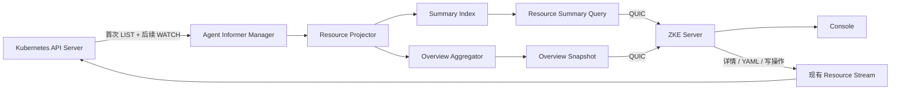

# 容器服务资源读取性能优化方案

> 状态：设计方案，尚未实现。
>
> 本文描述容器服务资源读取、列表展示与集群概览的性能优化方向。当前真实行为仍以
> [容器服务](container-service.md)和代码实现为准。

## 背景

ZKE 的容器服务遵循 Server + Agent 架构。Server 不直接访问 Kubernetes API Server，而是通过目标集群中的 Agent
执行资源查询。当前资源列表和集群概览复用通用 Resource Stream：Agent 调用 Kubernetes API，序列化完整对象后通过
QUIC 返回 Server，再由 Server 转换为面向 Console 的稳定响应。

该实现保持了集群边界和 Kubernetes 原生语义，但在 Pod 或工作负载较多、Agent 与 Server 之间带宽较低、多个用户并发
打开容器服务时，会重复付出以下成本：

- Kubernetes API Server 对完整对象进行 List、分页和序列化；
- Agent 接收并再次序列化完整对象；
- 完整 JSON 通过 Agent 到 Server 的链路传输；
- Server 反序列化完整对象后只保留列表或概览需要的少数字段；
- 多个缓存未命中的请求可能重复执行相同的集群级查询。

### 已确认的当前行为

- Agent 的通用资源读取直接调用 dynamic client 的 `List` 或 `Get`，没有为容器服务资源建立共享 Informer；
- Resource Watch 当前只服务 Kubernetes Event，并非容器服务资源的共享缓存；
- 一次概览冷加载分别读取 Node、Namespace、Pod、PV、PVC，以及 Deployment、StatefulSet、DaemonSet、Job、
  CronJob，共十类资源；
- 各部分默认每页 500 个对象、每类最多统计 10000 个对象，最多四路并行；
- Server 的成功概览快照默认缓存 15 秒，但同一集群的并发冷请求没有合并；
- 当前 Agent 只接受 `FULL_OBJECT` Resource 表示，Resource Body 是未压缩 JSON；
- Agent 主 Kubernetes Client 没有显式设置 QPS 和 Burst，使用 client-go 默认限流配置。

## 问题分析

### 概览当前是高成本读取

概览最终只返回状态计数和容量汇总，但当前实现需要 Server 经 Agent 获取十类资源的完整列表。Pod 部分还需要遍历所有
非终态 Pod，以 Kubernetes 调度语义计算 CPU 和内存 requests。

一次 List 不一定每次都直接读取 etcd。Kubernetes API Server 可以从 watch cache 服务部分读取，但 API Server 仍需承担
查询、对象复制、分页、编码、内存分配和网络发送；watch cache 未命中、ResourceVersion 变化或缓存重建时，存储层也可能
承担额外压力。因此，只把聚合代码从 Server 移到 Agent，而每次请求仍重新 List 全集，只能减少 QUIC 流量，不能消除
Kubernetes 控制面的重复读取。

### 简单提高 QPS 不是完整修复

提高 client-go QPS/Burst 可以减少 Agent 本地限流等待，但会把压力直接转移给 API Server。对于资源较小的单节点集群或
大量 Agent 同时重连的场景，过高的 QPS/Burst 可能造成更严重的控制面争用。必须先消除重复查询、限制并发，再根据测量结果调整限流参数。

### 单纯 gzip 仍然不够

gzip 能显著降低 Agent 到 Server 的 JSON 传输时间，适合带宽受限的私网、混合云与边缘环境。但 gzip 不会减少 API
Server List 次数、对象构造成本和 Agent 内存占用，因此应作为通用传输层优化，与资源缓存同时实施。

## 优化目标

- 容器服务的内置资源列表复用 Agent 内同一份资源缓存，不为概览单独维护一套 Informer；
- 缓存同步完成后，重复打开或刷新概览不再触发 Kubernetes 全量 List；
- 概览响应大小基本不随 Pod 数量增长；
- 资源列表传输量只随当前页的精简对象数量增长；
- 详情、YAML、写操作和实时能力继续保持 Kubernetes 原生语义；
- 不缓存 Secret 正文等敏感数据，不扩大现有权限和审计边界；
- Agent 缓存初始化、Watch 重连和高变更频率不能阻塞心跳、终端或资源写操作；
- Server 与 Agent 支持滚动升级，新 Server 可以安全回退到旧 Agent 的现有 Resource List；

## 总体设计

在 Agent 内新增统一资源读取模型 `ResourceCache`。Informer 负责从 Kubernetes 获取初始快照和增量事件，Projector 将
Kubernetes 对象转换为紧凑、稳定、无敏感正文的 Summary，Index 为列表查询提供索引，Aggregator 从相同数据增量维护
概览。



### 统一缓存，而非概览专用缓存

同一 GVR 在一个 Agent 进程内只建立一个 Informer，由以下消费者共享：

- 集群概览；
- Node、Namespace、Pod 和工作负载列表；
- 存储、服务、路由、自动伸缩与策略列表；
- 需要对象关联关系的 Describe 和诊断能力；
- AIOps 的只读资源检索，但每次工具调用仍需经过 Server 权限检查和目标集群定域。

概览不拥有独立对象副本，只消费统一缓存维护的聚合快照。

## 资源缓存范围

“统一资源缓存”指覆盖容器服务内置页面使用的可枚举资源，不表示无差别缓存 Kubernetes 中的所有资源和 CRD。

### 第一阶段：核心资源

| 资源 | 主要消费者 | 缓存内容 |
| --- | --- | --- |
| Node | 概览、节点列表 | 状态、版本、标签、污点摘要、容量与可分配量 |
| Namespace | 概览、命名空间列表 | 名称、阶段、删除状态、标签摘要 |
| Pod | 概览、Pod 列表、工作负载关联 | 身份、状态、调度位置、资源 requests、列表展示字段 |
| Deployment | 概览、工作负载列表 | 身份、副本状态、更新策略摘要 |
| StatefulSet | 概览、工作负载列表 | 身份、副本状态、更新策略摘要 |
| DaemonSet | 概览、工作负载列表 | 身份、调度状态摘要 |
| Job | 概览、工作负载列表 | 身份、完成与失败状态摘要 |
| CronJob | 概览、工作负载列表 | 身份、调度与暂停状态摘要 |
| PersistentVolume | 概览、存储列表 | 阶段、容量、访问模式、绑定摘要 |
| PersistentVolumeClaim | 概览、存储列表 | 阶段、申请容量、绑定摘要 |

### 第二阶段：常用扩展资源

- Service、Ingress 和 EndpointSlice；
- StorageClass；
- HorizontalPodAutoscaler；
- PodDisruptionBudget、NetworkPolicy、ResourceQuota 和 LimitRange；
- ReplicaSet 和 ControllerRevision，用于工作负载关联与修订历史。

EndpointSlice 等高频变更资源需要独立监控事件速率和 Agent CPU，必要时只缓存内置页面实际需要的投影。

### 不进入常驻完整缓存的内容

- Secret 正文；
- ConfigMap 大文本正文；
- Event 历史、Pod 日志；
- Exec、Terminal、Pod Access 和 Port Forward 数据；
- 任意第三方 CRD 的完整对象；
- `managedFields`、大 annotations 和页面不使用的状态细节。

Secret 列表如需缓存，只允许保存名称、Namespace、类型和时间等非敏感元数据。第三方 CRD 保持按需读取；未来只有在
产品页面明确需要时，才注册经过审查的专用 Summary Projector。

## Agent ResourceCache

### Informer 生命周期

- 核心资源在 Agent 建立连接后以随机抖动启动，避免大量 Agent 同时重连造成 LIST 风暴；
- 扩展资源可以根据 Discovery 结果和功能使用情况按需启动；
- 同一 GVR 只允许一个共享 Informer；
- 不配置周期性全量 relist；Watch 中断时从最后 ResourceVersion 恢复；
- ResourceVersion 过期或 watch cache 无法续接时允许重新 LIST，并记录原因和耗时；
- 初始同步并发受限，避免十类资源同时进行大 List；
- Agent 关闭时统一停止 Informer，确保 goroutine、Watch 和本地索引可回收。

缓存初始化使用独立、低优先级的 Kubernetes Client 配额，避免与资源详情、写操作、终端、日志和 Agent 心跳相关任务争抢
同一个限流预算。具体 QPS/Burst 默认值由压测确定，并保留配置上限。

### 紧凑投影

默认 SharedInformer 会缓存完整 Kubernetes 对象。对于大集群，这仍可能造成较高的 Agent 内存占用。核心资源必须通过
Transform 或专用 Store 丢弃无关字段，仅保留查询和增量聚合需要的信息。

Pod 的紧凑贡献对象至少包含：

```go
type PodContribution struct {
	UID                 types.UID
	Namespace           string
	Name                string
	ResourceVersion     string
	Labels              map[string]string
	NodeName            string
	PodIP               string
	Phase               string
	Ready               bool
	Terminating         bool
	Terminal            bool
	RestartCount        int32
	CreatedAt           time.Time
	CPURequestsMillis   int64
	MemoryRequestsBytes int64
}
```

资源 requests 的计算必须保持当前 Kubernetes 调度语义，包括普通容器、init container、restartable init container、
Pod-level resources 和 overhead。不能为了缩小缓存改变概览统计口径。

### 增量聚合

每类资源定义可加减的 Contribution。事件处理规则为：

- Added：加入新对象贡献；
- Updated：减去旧贡献，再加入新贡献；
- Deleted：减去旧贡献；
- DeletedFinalStateUnknown：从 tombstone 恢复身份并安全删除；
- 全量重新同步：先构建新快照，完成后原子替换，不能对外暴露半同步结果。

聚合结果使用不可变快照或原子指针发布。查询概览只复制小型统计结构，不遍历全部对象，也不持有 Informer Store 的长时间
读锁。

### 缓存健康状态

每个 GVR 至少维护：

- 是否完成初始同步；
- 最近成功同步时间；
- 最近 ResourceVersion；
- 最近事件时间和观察延迟；
- 最近 List/Watch 错误；
- Watch 重启次数；
- 当前缓存对象数；
- 是否正在重新同步。

Informer 尚未同步时，不能把“未知”返回成零。协议应返回 `warming_up`、section-level issue 或上一次成功快照，并明确标记
`stale`。

## 列表、详情和写操作语义

### 列表

容器服务内置列表优先查询 Agent Summary Index，支持：

- Namespace；
- Label Selector；
- 页面明确支持的字段过滤；
- 稳定排序；
- 有界分页；
- 缓存快照版本。

无法由缓存安全表达的复杂选择器或尚未缓存的 GVR 回退到现有 Kubernetes List。回退必须进入独立并发额度，并继续使用
Resource Body 压缩。

分页令牌应为不透明值，至少绑定集群、GVR、查询条件、缓存快照和当前位置。Agent 可以为一次查询保存有 TTL 和数量上限的
排序 Key 快照，使后续页面在短时间内读取相同缓存版本，避免资源变化导致大范围重复或遗漏。令牌不得包含敏感对象正文。

### 详情和 YAML

详情与 YAML 默认继续执行实时 Kubernetes GET，以满足以下要求：

- 返回用户此刻请求的完整对象；
- 保留 UID 和 ResourceVersion 前置条件；
- 不因缓存投影缺少字段而改变编辑语义；
- 不在 Agent 中长期保存 Secret、ConfigMap 正文或大型 CRD。

如列表刚收到写操作返回值，可以在 Console 短暂展示该返回值，但不能把它直接写入 Informer Store。

### 创建、更新和删除

写操作继续走现有专用权限、确认、幂等和审计路径：

1. Server 校验 Session、Tenant、Project、Cluster、Namespace、权限和确认；
2. Agent 向 Kubernetes API Server 发起写操作；
3. 成功后立即向调用方返回 Kubernetes 响应对象和 ResourceVersion；
4. Informer 从 Watch 观察该变更并更新缓存；
5. Console 在缓存追上写入 ResourceVersion 前可以显示“同步中”。

不要在写成功后手工修改 Informer Store，否则可能与 Watch 事件乱序并破坏缓存正确性。

## 概览快照协议

新增 Agent 能力 `overview_snapshot_v1`。新 Server 在授权完成后请求 Agent 当前缓存快照，Agent 不再为一次概览请求执行十类
Resource List。

快照至少包含：

- `generated_at`；
- `cache_synced`；
- `stale` 和 `last_success_at`；
- 各 section 的 ResourceVersion、同步状态和错误码；
- Node、Namespace、Pod、工作负载和存储统计；
- 统计是否因产品上限而截断。

十类 Kubernetes 资源没有跨 GVR 的统一 ResourceVersion，因此该快照仍是最终一致视图，不宣称为 Kubernetes 原子快照。

兼容策略：

- 新 Server + 新 Agent：使用 `OverviewSnapshot`；
- 新 Server + 旧 Agent：回退现有十类 Resource List；
- 旧 Server + 新 Agent：新 Agent 保留现有 Resource Stream 行为；
- 只有 Agent 明确声明能力后，Server 才能发送新请求。

## Server 侧请求合并与缓存

Agent 有 ResourceCache 后，Server 仍保留小型概览缓存，以吸收 Console 重复读取和网络抖动：

- 每个 Cluster 使用 singleflight，同一时刻只允许一个快照请求；
- 新鲜快照直接返回；
- 快照刚过期时返回 last-known-good，并由一个后台任务刷新；
- Agent 短暂离线时返回带 `stale` 标记的最后成功快照；
- 连续失败使用有上限的指数退避，避免用户刷新形成失败风暴；
- 手动刷新不能绕过 per-cluster 并发限制；
- 缓存键必须包含 Cluster ID，不得跨集群复用；
- 未授权请求不能利用缓存绕过 Tenant、Project 和 RBAC 检查。

缓存 TTL、最大 stale 时间和退避参数应配置化，并通过产品的 `generated_at`/`stale` 状态向用户解释数据新鲜度。

## QUIC Resource Body 压缩

ResourceCache 不替代通用传输压缩。详情、YAML、CRD、缓存回退和暂未迁移的列表仍可能返回大型 JSON。

计划为 Resource 协议增加：

- Request：调用方接受的内容编码；
- Response：实际内容编码、线传输大小和解压后大小；
- 能力协商：只有新 Server 声明支持 gzip 时，新 Agent 才发送 gzip；
- 旧端忽略未知字段并继续使用未压缩正文。

实现要求：

- 只压缩超过阈值的可压缩正文，初始候选阈值为 64 KiB 或 128 KiB，最终值由基准测试确定；
- 优先使用 gzip BestSpeed，避免压缩 CPU 成为新瓶颈；
- 同时限制线上大小、解压后大小和允许的压缩比；
- 解压过程遵守 Context 取消和请求超时；
- 校验正文完整性，失败只终止当前 QUIC Stream，不影响 Agent 连接；

## 流量控制和任务优先级

Agent 应把 Kubernetes 请求分为至少三类：

1. 高优先级：心跳相关任务、写操作、详情 GET、终端建立；
2. 普通优先级：用户列表和诊断读取；
3. 后台优先级：Informer 初始同步、Watch 重建和缓存预热。

每类使用独立或可预留的并发配额，防止大型 List 占满全部请求槽。Server 还应对同一 Cluster 的实时 List 设置有界并发，
超出时快速返回可识别的繁忙错误或排队，不能无限创建 QUIC Stream 和内存缓冲区。

QPS/Burst 的调整放在请求合并、缓存和优先级之后。配置需要有安全默认值和最大值，并记录 client-go throttle duration，避免
仅观察最终 HTTP 超时而看不到 Agent 内部等待。

## 实施阶段

### 阶段一：传输和 Server 止损

- 实现 Resource Body gzip 能力协商；
- 为概览增加 per-cluster singleflight；
- 增加 last-known-good、stale-while-revalidate 和失败退避；
- 保持现有资源读取行为作为兼容基线。

### 阶段二：ResourceCache 基础设施

- 新建 Agent ResourceCache、Informer Registry、Projector、Index 和健康状态模型；
- 实现核心资源的紧凑投影；
- 实现启动抖动、同步并发、Watch 恢复和关闭流程；

### 阶段三：概览切换

- 实现增量 Aggregator 和不可变 Overview Snapshot；
- 增加 `overview_snapshot_v1` 能力协商；
- 新 Server 优先读取 Agent 快照，旧 Agent 自动回退；
- 验证统计口径与当前实现一致。

### 阶段四：列表切换

- Pod、Node、Namespace 和五类工作负载先切换到 Summary Index；
- 再迁移存储、服务、路由、自动伸缩和策略列表；
- 详情、YAML 和写操作保留实时路径；
- 为不支持的过滤条件和未同步缓存提供可观察的回退。

### 阶段五：调优和收敛

- 基于压测调整缓存投影、QPS/Burst、同步并发和 gzip 阈值；
- 评估是否保留旧概览 List 路径及其支持周期；
- 更新容器服务文档和 Server OpenAPI 契约；
- 在兼容窗口结束前不删除旧协议字段和旧 Agent 路径。

## 验证方案

### 数据规模

使用 KWOK 或等价测试环境，至少覆盖：

- 基线小集群；
- 1000、10000 Pod；
- 多 Namespace、多 Node；
- Deployment、StatefulSet、DaemonSet、Job 和 CronJob 混合；
- 高 Pod 创建/删除速率；
- 低带宽、高 RTT 和丢包链路；
- Agent 与 Server 不同版本组合。

资源规模应逐级增加，同时监控测试集群可用内存和 API Server 健康；不能在控制面资源不足时继续扩容并把 OOM 或控制面阻塞
误判为单纯的 ZKE 网络性能问题。

### 功能正确性

- Informer 首次同步后的统计与直接 Kubernetes List 结果一致；
- Added、Updated、Deleted 和 tombstone 后统计正确；
- Watch 断线、ResourceVersion 过期和 Agent 重启后能够恢复；
- 终态 Pod 不计入 requests，调度语义与当前实现一致；
- Namespace、Cluster 和资源身份不会在缓存查询中丢失；
- 未授权用户不能读取缓存中的其他 Namespace 或资源；
- Secret 和 ConfigMap 正文没有进入 Summary Store；
- 写操作完成后，缓存最终观察到对应 ResourceVersion。

### 性能验收

以下为验收原则，具体数值阈值在基准环境建立后确定：

- 缓存同步后，连续刷新概览产生零次 Kubernetes 全量 List；
- 同一集群多个并发概览请求只产生一次 Agent 快照请求；
- 概览 QUIC 正文大小不随 Pod 数量线性增长；
- 列表 QUIC 正文大小只随当前页 Summary 数量增长；
- Agent 内存按紧凑对象数量线性、可解释地增长，没有完整对象字段意外保留；
- 高变更频率下 Watch 事件延迟有界，不阻塞 Agent 心跳和交互式请求；
- gzip 在低带宽场景显著降低传输时间，且压缩 CPU 不抵消收益；
- API Server 的 List 次数从“按用户请求重复”降为“Informer 初始化或必要重建时发生”；
- 旧 Server/新 Agent、新 Server/旧 Agent 均能正常工作。

### 故障注入

- 中断 Agent 到 Server 的连接；
- 中断 Agent 到 Kubernetes API Server 的连接；
- 让 Watch 返回 410 Gone；
- 让单个 GVR RBAC 被拒绝；
- 构造超大对象和高压缩比正文；
- 触发 Server 超时和请求取消；
- 在缓存预热期间发起列表、详情和写操作；
- 同时启动大量 Agent，验证随机抖动和控制面保护。

## 不在本方案中的范围

- 不把 Server 改为直接访问 Kubernetes API Server；
- 不用 Informer 替代 Kubernetes 作为事实来源；
- 不把容器服务做成跨集群写操作入口；
- 不缓存 Secret 正文、日志或终端数据；
- 不承诺缓存任意 CRD；
- 不用简单延长 HTTP 超时掩盖全量读取和并发问题；
- 不在缺少基准数据前固定最终 QPS/Burst、缓存 TTL 或 gzip 阈值。

## 预期结果

完成本方案后，容器服务的常用列表和概览将从“每个用户请求触发远程完整对象读取”变为“Agent 维护一份受控的集群资源
读模型，Server 按权限查询紧凑结果”。API Server 主要承担一次初始 LIST 和后续增量 Watch，Agent 到 Server 的流量以
Summary 和聚合快照为主；详情、YAML 和写操作继续实时访问 Kubernetes，从而在性能、数据新鲜度、内存成本和原生语义
之间保持清晰边界。
